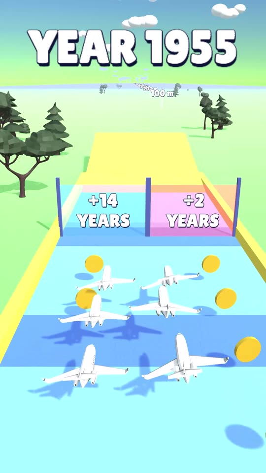
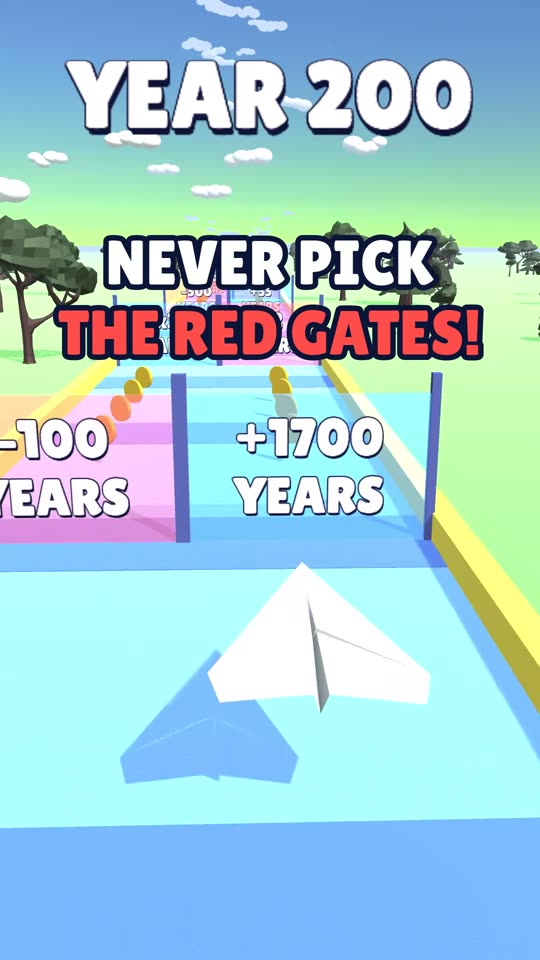
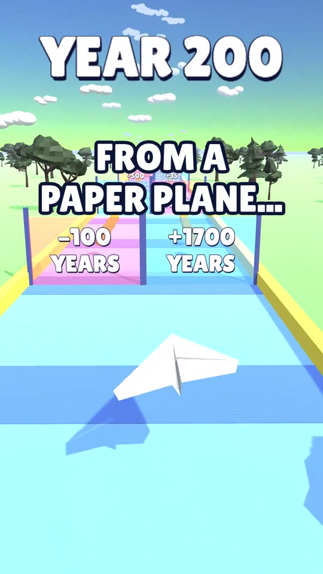
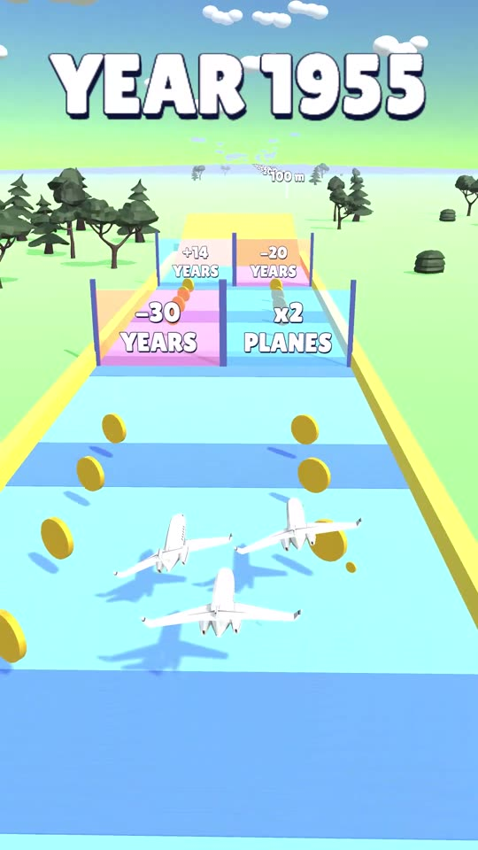

# Epic Plane Evolution

A hyper-casual concept and 3 video ads to test it, made in **Unity 6**: fly through the right gates to evolve
your plane, from a paper plane to a rocket, then launch off the ramp as far as you can.

**Play the prototype and watch the ads:** [davidbarredo.netlify.app](https://davidbarredo.netlify.app/en.html#planes)

## The 3 ads: one creative hypothesis each

| Ad | Hypothesis | Video |
|---|---|---|
| A · The fail | A ridiculous run ("never pick the red gates") makes people think "I'd do better" |  |
| B · The evolution | The spectacular win, from paper all the way to space, sells the fantasy |  |
| C · So close | Climbing to jets, then two last-second wrong gates: frustration that makes you want to play |  |

What I would measure: click-through rate, cost per install and view retention (3 s, end of video), then
iterate on the hook of the winning ad.

## How it works

- **Gates** change the year (`+1700 years`, `÷2`...) or multiply the squadron (`x3 planes`). The year picks the
  era: paper plane → biplane → propeller → jet → rocket (`EraTable`). More planes = more distance.
- **The ramp** at the end launches the squadron: each era flies its own distance, the paper plane nose-dives
  and crashes, the rockets go to space.
- **Ad takes are recorded in Unity** (`AdRecorder`, Unity Recorder, 1080x1920 with game audio). A scripted
  autopilot plays like a human: it weaves around, hesitates, grabs coins, and on the fail takes heads for the
  good gate then swerves into the bad one at the last moment (`Player.AutopilotTarget`, `GatePair.feint`).
- **The whole scene is generated by an editor script** (`AdSceneBuilder`): one menu builds the main level and
  the fail / "so close" variants, so every take is reproducible.
- **Readable texts on any background**: outlined labels that shrink to fit the portrait screen.

The web build is the playable version: hold and drag to steer, tap to retry.

## Run it

1. Unity **6000.5** (built-in render pipeline). Open the folder with Unity Hub.
2. `Plane Evolution > Build Ad Scene` (and the Fail / Mid variants), then Play `Assets/_Project/Scenes/Main.unity`.
3. `Plane Evolution > Record Raw Videos` records the three takes into `Recordings/`.

## How it was made

I designed the concept, directed the ads and drove every iteration (camera, pacing, fake-outs, text
readability). The code and the ad editing (ffmpeg) were done with AI (Claude).

## Credits

See [`Assets/_Project/Models/CREDITS.txt`](Assets/_Project/Models/CREDITS.txt): plane models from Poly Pizza
(CC-BY 3.0, authors listed), trees by Quaternius (CC0), sounds by Kenney (CC0), Lilita One font (OFL).
Music in the ads: "Pixelland" by Kevin MacLeod (incompetech.com), CC BY 4.0.
